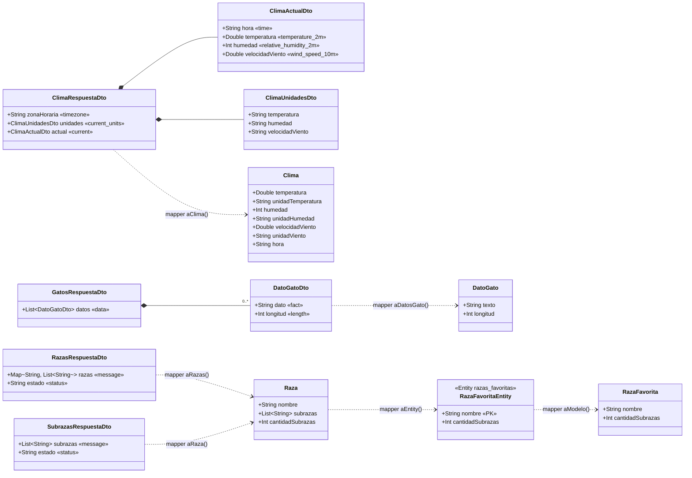

# DISENO.md: Explorador de naturaleza y clima (Grupo 2)

## (a) Diseño de clases

Flujo de los datos: **JSON de la API → DTO → Mapper → modelo del dominio → ViewModel (UiState) → pantalla**.
Para la persistencia: **modelo del dominio ↔ Mapper ↔ RazaFavoritaEntity (Room)**.



Notas:

- Los campos de los DTO son **nullable** (`?`) porque Gson no respeta la null-safety de Kotlin: si la API no envía un campo, el mapper lo detecta en vez de que la app se caiga.
- `«message»`, `«current»`, etc. es el nombre real en el JSON (`@SerializedName`).
- `RazasRespuestaDto.razas` es un **mapa** (nombre de la raza → lista de subrazas), no un arreglo; el mapper lo convierte en `List<Raza>`.
- `Resultado<T>` (sealed interface con `Exito(datos)` y `Error(mensaje)`) es lo que devuelven los repositorios.

## (b) Diseño de la base de datos (Room)

Base de datos `explorador.db`, versión 1.

**Tabla `razas_favoritas`** (entidad `RazaFavoritaEntity`)

| Columna | Tipo Kotlin | Tipo SQLite | Nulo | Clave |
| --- | --- | --- | --- | --- |
| `nombre` | `String` | `TEXT` | NOT NULL | **PRIMARY KEY** |
| `cantidadSubrazas` | `Int` | `INTEGER` | NOT NULL | |

Operaciones del DAO (`RazaFavoritaDao`):

| Función | Tipo | SQL |
| --- | --- | --- |
| `observarTodas()` | `Flow<List<RazaFavoritaEntity>>` | `SELECT * FROM razas_favoritas ORDER BY nombre` |
| `esFavorita(nombre)` | `Flow<Boolean>` | `SELECT EXISTS(SELECT 1 FROM razas_favoritas WHERE nombre = :nombre)` |
| `insertar(raza)` | `suspend` | `@Insert(onConflict = REPLACE)` |
| `eliminarPorNombre(nombre)` | `suspend` | `@Query("DELETE FROM razas_favoritas WHERE nombre = :nombre")` |

## (c) Capas de MVVM y su contenido

```
ui/  (View)                 ← pantallas Compose: solo dibujan y avisan eventos
   ↕  estado (StateFlow) ↓   eventos (onClick) ↑
ui/viewmodel/ (ViewModel)   ← UiState, StateFlow, reintentar(), marcarFavorita()
   ↕
repository/  (Model)        ← decide de dónde vienen los datos, devuelve Resultado
   ↕                    ↕
api/ + mapper/          db/ + mapper/
(Retrofit, DTO)         (Room: Entity, DAO, Database)
```

| Capa MVVM | Paquete | Contenido |
| --- | --- | --- |
| **View** | `ui/screens`, `ui/componentes`, `ui/navegacion` | `RazasScreen` (lista + buscador), `DetalleRazaScreen`, `ClimaScreen`, `GatosScreen`, `FavoritasScreen`, `AppNavegacion`, `PantallaCargando`, `PantallaError` |
| **ViewModel** | `ui/viewmodel` | `RazasViewModel`, `DetalleRazaViewModel`, `ClimaViewModel`, `GatosViewModel`, `FavoritasViewModel` (cada uno con su `UiState` y `StateFlow`) |
| **Model** | `model`, `repository`, `mapper`, `api`, `db` | Modelos del dominio y `Resultado`; `RazaRepository`, `ClimaRepository`, `GatoRepository`, `FavoritasRepository`; mappers; servicios Retrofit + `RetrofitClient` (una instancia por baseUrl) + DTO; Room (`RazaFavoritaEntity`, `RazaFavoritaDao`, `AppDatabase`) |

Reglas que se respetan:

- La View nunca llama a la API ni a Room; solo observa el `UiState` y llama funciones del ViewModel.
- El ViewModel no conoce la View (no tiene referencias a Composables ni a la Activity).
- La capa de datos no importa nada de `ui`.
